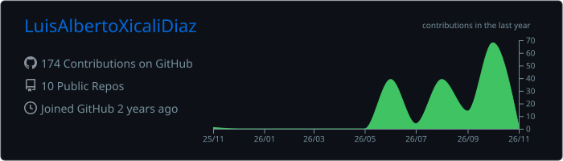
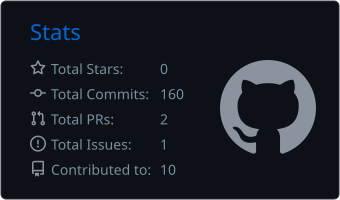
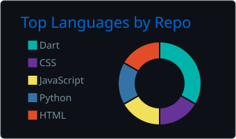

<!-- ═══════════════════ HEADER ═══════════════════ -->

 

  

  

<!-- ═══════════════════ SOBRE MÍ ═══════════════════ -->

<h2 align="center">👨‍💻 Sobre mí</h2>

Desarrollador de software apasionado por **construir soluciones que resuelvan problemas reales** y por asegurar que funcionen como deben. Me muevo entre el desarrollo y la calidad: me gusta crear, pero también probar, romper y mejorar.

He construido plataformas web full-stack con chat en tiempo real, portales de empleo con despliegue en la nube, apps móviles en Flutter, herramientas de escritorio en Python y videojuegos.

 

<table align="center">
<tr>
<td width="50%" valign="top">

### 🧪 Experiencia

**Junior QA Analyst Intern** · eScire México

- 🔍 Pruebas y validación de software
- 🧬 Diseño de casos de prueba
- 🐞 Identificación y documentación de defectos

**Cloud & Documentación técnica** · TalentHub México

- ☁️ Despliegues y recursos en Azure
- 📚 Estructura de la wiki del proyecto

</td>
<td width="50%" valign="top">

### 🎯 Intereses

- 🌐 Desarrollo Full-Stack
- 📱 Apps móviles multiplataforma
- 🔬 QA y pruebas de software
- 🎮 Videojuegos y experiencias 3D
- 🤖 Automatización con Python

</td>
</tr>
</table>

<!-- ═══════════════════ PROYECTOS ═══════════════════ -->

<h2 align="center">🚀 Proyectos destacados</h2>

<table>
<tr>
<td width="50%" valign="top">

### 🗂️ [CoLabTy](https://github.com/LuisAlbertoXicaliDiaz/CoLabTy-)
Plataforma colaborativa de gestión de proyectos: **tableros Kanban** con **chat en tiempo real** por tablero, autenticación JWT con verificación de correo y recuperación de contraseña.

</td>
<td width="50%" valign="top">

### 💼 [TalentHub México](https://github.com/LuisAlbertoXicaliDiaz/talenthub-mexico)
Observatorio y bolsa de empleo del sector TI con **3 roles** (aspirantes, empresas y administración), validación de CV y datos de contacto protegidos. Trabajo en equipo: me encargué de **infraestructura en Azure** y **documentación técnica**.

</td>
</tr>
<tr>
<td width="50%" valign="top">

### 🏴‍☠️ Islas del Botín
Videojuego para **Roblox** en desarrollo: combate, economía con generadores mejorables, tiendas, tabla de clasificación y guardado de progreso, escrito en Luau con Rojo.

</td>
<td width="50%" valign="top">

### 🎯 [IG Hunter Pro](https://github.com/LuisAlbertoXicaliDiaz/IG-Hunter-Desktop)
App de escritorio que analiza **de forma local** los datos exportados de Instagram: quién no te sigue de vuelta, seguidores mutuos, solicitudes pendientes e historial, sin pedir tu contraseña.

</td>
</tr>
<tr>
<td width="50%" valign="top">

### 🚀 [Nebula Crew](https://github.com/LuisAlbertoXicaliDiaz/nebula-crew)
Juego cooperativo para 3 jugadores: Piloto, Analista e Ingeniero ven información distinta y deben comunicarse para reparar los sistemas de una nave antes de que se acabe el tiempo.

</td>
<td width="50%" valign="top">

### 🌱 [Talentry](https://github.com/LuisAlbertoXicaliDiaz/Talentry)
Plataforma web que conecta estudiantes y jóvenes profesionales con empresas: búsqueda de vacantes con filtros, modo claro/oscuro, diseño adaptable y cuentas con Firebase.

</td>
</tr>
</table>

<b>📁 Más proyectos</b>

 

| Proyecto | Descripción | Tecnologías |
|:--|:--|:--|
| [Consultas Médicas](https://github.com/LuisAlbertoXicaliDiaz/Consultas-Medicas) | Sistema web de citas: calendario, registro y perfil de paciente | HTML · CSS · JavaScript · PHP |
| [App de Hábitos](https://github.com/LuisAlbertoXicaliDiaz/Aplicacion_Habitos) | App móvil para registrar y dar seguimiento a hábitos | Flutter · Dart |

 

<!-- ═══════════════════ TECH STACK ═══════════════════ -->

<h2 align="center">⚡ Stack tecnológico</h2>

| Área | Tecnologías |
|:---:|:---:|
| **🎨 Frontend** |  |
| **⚙️ Backend** |  |
| **📱 Mobile** |  |
| **🗄️ Datos** |  |
| **☁️ Cloud y herramientas** |  |
| **🎮 Game Dev** |   |

 

**🧪 Quality Assurance**

<!-- ═══════════════════ ANALYTICS ═══════════════════ -->

<h2 align="center">📊 GitHub Analytics</h2>

<!-- Tarjetas generadas por el workflow profile-cards.yml -->

  

  

<!-- Snake animada (workflow snake.yml) -->
<picture>
  <source media="(prefers-color-scheme: dark)" srcset="https://raw.githubusercontent.com/LuisAlbertoXicaliDiaz/LuisAlbertoXicaliDiaz/output/github-contribution-grid-snake-dark.svg" />
  <source media="(prefers-color-scheme: light)" srcset="https://raw.githubusercontent.com/LuisAlbertoXicaliDiaz/LuisAlbertoXicaliDiaz/output/github-contribution-grid-snake.svg" />
  
</picture>

<!-- ═══════════════════ CONTACTO ═══════════════════ -->

<h2 align="center">🌌 Vamos a conectar</h2>

 

  

Diseñado con 💜 y muchas ganas de seguir creciendo.

